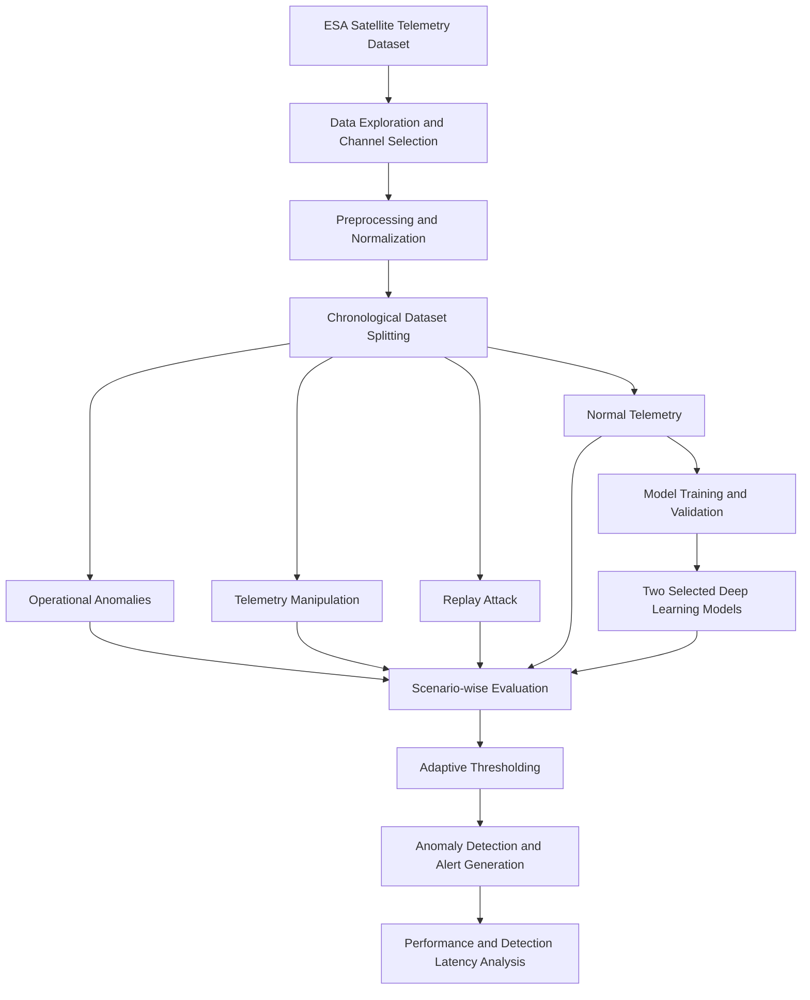

# Adaptive Cybersecurity Model for Secure Satellite Communication

**M.Tech Research Project | Information Security**  
K. J. Somaiya School of Engineering, Mumbai

**Project Status:** Ongoing — Dataset Preparation and Validation Completed; Model Implementation in Progress

## 1. Project Overview

This research aims to develop an adaptive cybersecurity model for satellite communication systems using multivariate satellite telemetry analysis, deep learning-based anomaly detection, controlled cyberattack simulation, and adaptive thresholding.

The proposed model investigates the detection of operational anomalies and telemetry-based cyberattacks while evaluating detection accuracy, false alarm rates, and detection latency.

## 2. Research Objectives

- Establish a realistic satellite telemetry baseline using the European Space Agency Anomalies Dataset (ESA-AD).
- Generate controlled and labelled telemetry manipulation and replay attack scenarios.
- Implement and compare two suitable recent deep learning-based anomaly detection models.
- Develop an adaptive thresholding mechanism to improve detection reliability under changing telemetry conditions.
- Investigate opportunities to reduce detection latency while maintaining reliable anomaly detection.

## 3. Dataset

**Dataset:** European Space Agency Anomalies Dataset (ESA-AD v2)

**Current Scope:** Mission 1

| Parameter | Details |
|---|---|
| Available telemetry channels | 76 |
| Selected channels | channel_14, channel_21, channel_29 |
| Sampling interval | 90 seconds |
| Window length | 20 timesteps |
| Input dimensions | 20 × 3 |
| Data splitting | Chronological 60:20:20 |
| Normalization | StandardScaler fitted on training data |

The dataset contains real satellite telemetry and annotated operational events. Controlled cyberattack scenarios are generated separately for cybersecurity evaluation.

## 4. Evaluation Scenarios

| Scenario | Description |
|---|---|
| Normal Telemetry | Candidate nominal satellite telemetry windows |
| Operational Anomalies | Real annotated anomalies from ESA-AD |
| Telemetry Manipulation | Controlled modification of telemetry measurements |
| Replay Attack | Controlled substitution of current telemetry with historical telemetry segments |

Operational anomalies are not automatically classified as cyberattacks. The primary detection task is anomaly identification, with attack-specific performance evaluated using controlled scenario labels.

## 5. Proposed Methodology

## 6. Completed Dataset Preparation

| Dataset Category | Training | Validation | Testing | Total |
|---|---:|---:|---:|---:|
| Normal candidates | 18,947 | 17,868 | 18,262 | 55,077 |
| Operational anomalies | 552 | 388 | 345 | 1,285 |
| Telemetry manipulation | 300 | 300 | 300 | 900 |
| Replay attacks | 300 | 300 | 300 | 900 |
| **Total** | **20,099** | **18,856** | **19,207** | **58,162** |

An additional 900 paired normal control windows are maintained separately for controlled attack comparisons.

Dataset integrity, source consistency, chronological separation, and generated attack consistency checks have been performed.

The total represents prepared window records rather than independent satellite events.

## 7. Model Selection

Recent multivariate time-series anomaly detection architectures are being investigated based on:

- Compatibility with satellite telemetry
- Research relevance and publication quality
- Availability of reproducible implementations
- Computational requirements
- Anomaly detection capability
- Detection latency considerations

Two models will be finalized following technical compatibility checks and pilot experiments.

## 8. Adaptive Detection Mechanism

The proposed adaptive mechanism will recalibrate anomaly detection thresholds using chronological validation blocks while maintaining fixed trained model weights.

Threshold selection will aim to minimize false positives while satisfying a predefined recall requirement.

This mechanism is currently under development.

## 9. Performance Evaluation

The proposed evaluation includes:

- Accuracy
- Precision
- Recall
- F1-score
- False Positive Rate (FPR)
- False Negative Rate (FNR)
- Event-level detection performance
- Detection latency
- Model inference time
- Anomaly Detection Timing Quality Curve (ADTQC), where applicable

Detection latency and computational inference time will be measured separately.

Comparison with the original ESA anomaly detection benchmark will be conducted under comparable experimental conditions wherever feasible.

## 10. Technologies and Development Environment

| Technology | Purpose |
|---|---|
| Python 3.12 | Research implementation |
| NumPy | Numerical and telemetry processing |
| Pandas | Data analysis and preprocessing |
| Scikit-learn | Normalization and performance evaluation |
| PyTorch 2.11.0 | Deep learning implementation |
| CUDA 12.8 PyTorch build | GPU-accelerated computation |
| Visual Studio Code | Development environment |
| GitHub | Version control and research documentation |

Additional model-specific and cybersecurity-related libraries will be incorporated following compatibility and relevance assessment.

### Hardware Environment

- NVIDIA GeForce RTX 3050 Laptop GPU
- 6 GB GPU memory
- 16 GB system RAM
- Windows operating system

GPU availability and basic PyTorch GPU computation have been successfully verified.

## 11. Research Progress

- [x] Literature survey
- [x] Dataset exploration
- [x] Telemetry channel selection
- [x] Data preprocessing and normalization
- [x] Chronological dataset splitting
- [x] Telemetry manipulation simulation
- [x] Replay attack simulation
- [x] Operational anomaly extraction
- [x] Dataset integration and integrity verification
- [x] GPU-enabled development environment setup
- [ ] Model compatibility assessment
- [ ] Pilot model experiments
- [ ] Final selection of two models
- [ ] Model training and validation
- [ ] Adaptive threshold implementation
- [ ] Detection latency evaluation
- [ ] Benchmark comparison
- [ ] Monitoring dashboard
- [ ] Final research documentation

## 12. Dataset and Research References

- ESA Anomaly Detection Benchmark: https://github.com/kplabs-pl/ESA-ADB
- European Space Agency Benchmark for Anomaly Detection in Satellite Telemetry: https://arxiv.org/abs/2406.17826

## 13. Research Status and Limitations

This repository documents ongoing academic research. Model performance, cybersecurity detection effectiveness, and latency improvements will be reported following experimental validation.

Raw datasets, large generated files, trained model weights, and local virtual environments are not intended to be included in the repository by default.

---

**M.Tech — Information Security**  
**Research Area:** Satellite Cybersecurity, Multivariate Time-Series Anomaly Detection and Adaptive Detection Systems
